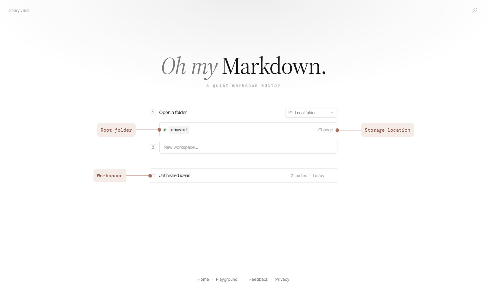
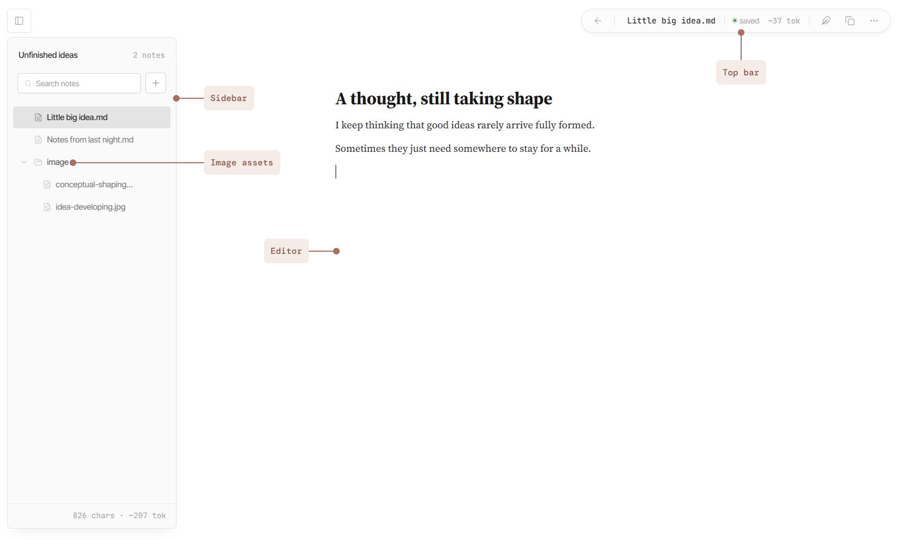
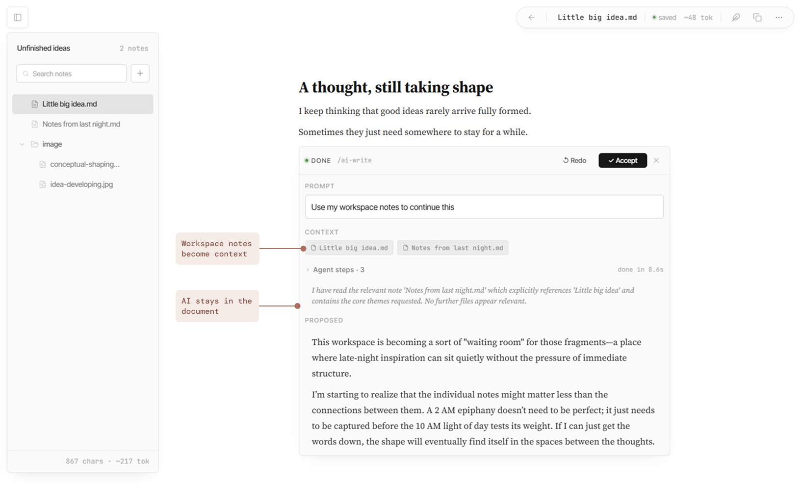

# A three-minute tour

This is a temporary playground where you can explore how OhMyMD works. Edit this note, create your own, try AI, and make anything you like—nothing you change here will be saved. 🤗

## 1. Choose where your writing lives

When you start using OhMyMD, you first choose where your work lives.

* **Local folder:** Choose a folder on your computer as your OhMyMD root folder, then create workspaces inside it.

* **Google Drive:** Choose a folder in Google Drive as your root folder and reopen the same workspaces from another device.

* **Browser:** Start immediately and keep your workspaces in this browser.

For Local Folder and Google Drive, the root folder can contain multiple workspaces. Think of each workspace as a focused collection of notes, folders, and assets for one project or subject. Keeping related material together also gives AI clearer context to work with.

Your notes stay in portable Markdown, whichever storage option you choose.

## 2. Get around your workspace

OhMyMD keeps the interface simple while letting your work grow beyond a single document.

* **Sidebar:** Organize notes, folders, and image assets in one workspace. Images you add can be kept in the workspace image folder, while workspace-level character and token counts show how much material you're working with.

* **Editor:** Write in a focused Markdown canvas, with AI and richer content tools appearing directly in the document when you need them.

* **Top bar:** See the current note's file name, save status, and token usage, open the Markdown Guide, or go to Settings to choose a model and add the API key needed for cloud AI providers.

## 3. Write first. Bring in AI when you need it.

OhMyMD is a writing tool first. AI stays inside the writing flow and enters when you ask for it.

When you use an AI tool, OhMyMD can look across the workspace for relevant notes instead of relying only on the current document. In AI Write, you can see your prompt, the workspace notes used as context, agent progress, and the proposed result before deciding whether to accept it.

You can stop generation, revise or redo a request, and decide whether to accept the result.

* **AI Write:** Type `/ai-write` or choose AI Write from the slash menu to develop an idea, draft new content, or continue a passage.

* **AI Comment:** Select something you've written, then choose AI Comment to refine, rewrite, or respond to it. Review the proposed change before accepting it.

* **AI Draw:** Type `/ai-draw` or choose AI Draw from the slash menu to turn an idea or description into a visual.

## 4. Go beyond plain text

Beyond plain text and AI-assisted writing, OhMyMD gives you more ways to structure and express information. Type `/` on an empty line to explore them.

* **Tables:** Compare and organize information in a structured format.

* **Diagrams:** Use Mermaid to map relationships, systems, and flows.

* **Math:** Write and render LaTeX equations directly in your notes.

* **Images:** Paste, reference, or generate images alongside your writing. Image assets are kept in the workspace image folder and referenced from your notes, keeping your writing and its assets together.

## 5. Share and extend

* **GitHub sharing:** Keep an OhMyMD workspace in a local Git repository, commit and push it to a public GitHub repository with your usual Git tools, then open the repository through OhMyMD and share the URL. Visitor changes stay temporary.

* **AI agent access:** If you use an AI agent that can work in your browser, point it to `ohmy.md/agent/skills`. The guide shows it how to find your Browser Storage or Local Folder workspace, inspect its files, read notes, make supported updates, and verify its changes.

## 6. Try anything here

Modify this note, create a new note or folder, move things around, try a slash command, or ask AI to help.

Your changes disappear when you leave or refresh the Playground, so feel free to explore.

When you're ready to keep your work, return to **ohmy.md** and choose where you want your workspace to live.
